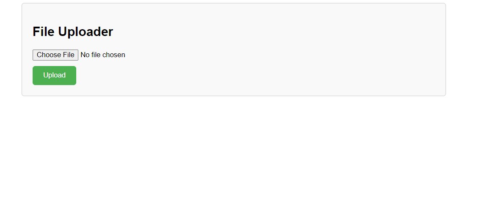
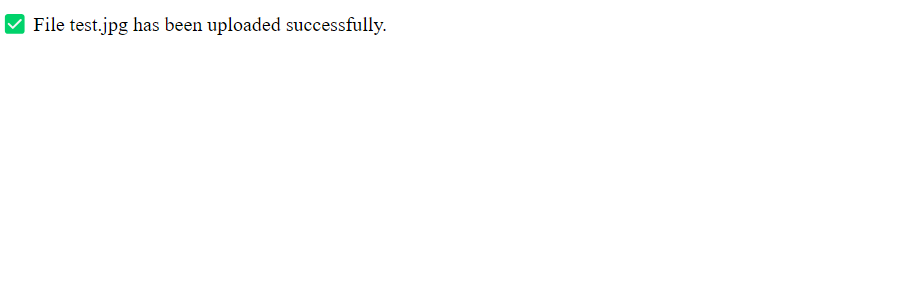

# File uploader 📁

A small image-upload demonstration, intended for **local development only**. It accepts JPEG, PNG and GIF files up to **500 KB**, checks their actual content, generates unpredictable storage filenames, and keeps files **outside the web-accessible directory** by default.

## Run locally

Requires **PHP 8.1+** with the `fileinfo` extension (enabled by default on standard PHP installations).

```bash
git clone https://github.com/new92/php.git
cd php/"File uploader"
php -S 127.0.0.1:8080
```

Open <http://127.0.0.1:8080/index.html>, choose an image, then upload it. A successful upload returns HTTP **201**.

Images are stored under your operating system's temporary directory, in the `new92-php-image-uploads` folder. To choose another **private, non-web-accessible** directory, set `PHP_DEMO_UPLOAD_DIR` before starting the server. Example (macOS/Linux):

```bash
PHP_DEMO_UPLOAD_DIR=/path/to/private/uploads php -S 127.0.0.1:8080
```

On Windows PowerShell, use `$env:PHP_DEMO_UPLOAD_DIR='C:\private\uploads'` followed by `php -S 127.0.0.1:8080`.

**Security:** Do not expose this demo directly to the public internet. It does not provide authentication, rate limiting, malware scanning, or upload quotas. In production, you must add these controls and configure PHP/web-server body-size limits, storage access controls, and lifecycle cleanup.

## Screenshots




